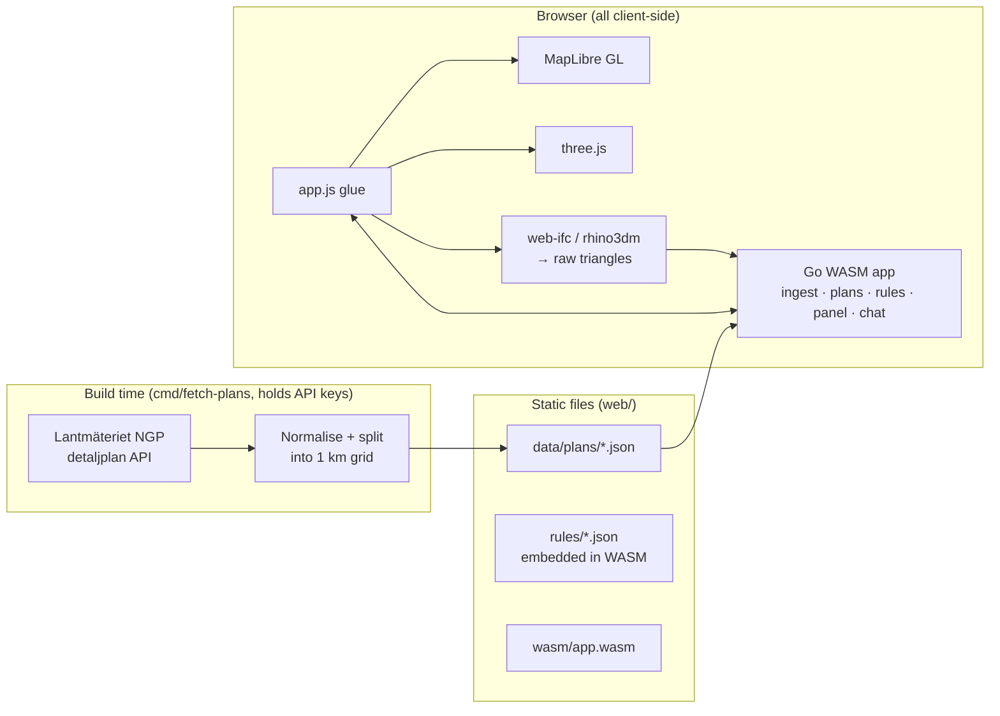

# [App name]

> Working title — the name is still open (the mockups say *"[Insert name of app]"*).

A web tool for architecture students to check whether a building design fits the **detaljplan** for its site and the **Swedish building regulations** (Boverket's byggregler). Drop a pin on the map, import a model from Revit, Rhino or SketchUp, and get a list of what passes, what fails, and what has to be checked by hand — with each problem linked to the exact part of the model and the regulation it comes from.

The whole app is a **static web page**: no login, no backend, and the model never leaves the student's computer. Heavy work (reading models, running the rule checks) happens in the browser with **WebAssembly**.

Built as a project in a human–computer interaction course.

---

## Design

### 1. Start: pick a site


- Full map of the city using Lantmäteriet's grey (*nedtonad*) topographic map style.
- Areas covered by a digital detaljplan are outlined on the map.
- The right-hand panel invites the user to *drop a pin to see the details*.
- **Import design** (top right) opens the model import.
- The input at the bottom (*Start asking…*) lets the user ask questions about the site or the results. The paperclip attaches a model file.

### 2. Pin dropped: site details


- Dropping a pin selects the property (fastighet) and the detaljplan that covers it.
- The panel shows the address (here *Valhallavägen 201*) and the plan's key regulations: allowed use, max height, building area, prickmark, plan ID and date it became legally binding (*laga kraft*).

### 3. Check results: problems with the regulations


- A list of everything in the model that breaks a rule, for example:
  - *Window [name in model] too small*
  - *Bathroom needs to be at least [x] m²*
  - *Ceiling height needs to be at least [x] m*
- Selecting a problem shows the failing element (here a window) and the rule text with a link to its source.

---

## What it should do

### Site and detaljplan
- Search for an address or property, or drop a pin on the map.
- Find the detaljplan that applies at that point and show its regulations in plain language.
- Draw plan areas on the map: building zones, **prickmark** (land that may not be built on), **korsmark**, height limits, and so on.
- Older plans that only exist as scanned PDFs are shown as a link to the PDF, with a clear note that they **can't be checked automatically**.

### Model import

| Program | How to get the model into the app | Read in the browser with |
|---|---|---|
| **Revit** | Export as **IFC** (File → Export → IFC) | [`web-ifc`](https://github.com/ThatOpen/engine_web-ifc) (WASM) |
| **Rhino** | Upload the **.3dm** file directly, or export as IFC | [`rhino3dm.js`](https://github.com/mcneel/rhino3dm) (WASM) |
| **SketchUp** | Export as **IFC** (SketchUp Pro). There's no browser reader for `.skp` files | `web-ifc` (WASM) |

- IFC is the main format because it carries meaning: walls, windows, rooms and storeys, not just shapes. Room-based checks (bathroom size, ceiling height) need that.
- `.3dm` files carry geometry and layers but not much meaning. The app asks the user to map layers to building parts (for example *"Layer `Fönster` = windows"*) or limits itself to volume checks (height, footprint, position).
- **Placement:** student models are rarely georeferenced. After import, the user moves and rotates the building into place on the map. IFC files that already have coordinates in SWEREF 99 TM are placed automatically.

### Checks
Two groups of checks, shown separately:

**Detaljplan** — checked against the model's volume and position:
- Height (nockhöjd, byggnadshöjd, totalhöjd)
- Building area (byggnadsarea, BYA) and floor area (BTA), as m² or % of the property
- Number of storeys
- Building on prickmark or outside allowed zones
- Distance to the property boundary

**Building regulations** — checked against rooms and elements in the model:
- Room sizes (for example bathroom area)
- Ceiling heights
- Window sizes and daylight-related minimums
- Accessibility basics (door widths, entrance level)

Every check ends in one of four states:

| State | Meaning |
|---|---|
| ✅ Pass | The model meets the rule |
| ❌ Fail | The model breaks the rule — shows by how much, and where |
| 👁 Check manually | The rule needs human judgement (for example *"anpassas till omgivningen"*) |
| ❔ Missing data | The model lacks what's needed (for example no rooms in the IFC) |

The app must **never show a pass it can't back up**. When it's unsure, it says so.

### Questions (chat panel)
The *Start asking…* field lets users ask things like *"Why does my window fail?"* or *"What does e1 mean in this plan?"*.

> ⚠️ **Open question:** a real AI assistant needs a language model API, which means an API key and therefore a server (see [API keys](#api-keys-and-why-there-is-no-runtime-backend)). Options:
> 1. Rule-based answers only: explain any check or plan regulation from the data the app already has. Works fully static.
> 2. Add a small serverless function that holds the LLM key. Breaks the "no backend" goal.
> 3. Treat it as a design concept in the prototype and test it with a Wizard-of-Oz setup.
>
> For the HCI course, option 1 or 3 is enough.

---

## Run it

Needs only [Go](https://go.dev/dl/) 1.27+. No Node, npm or TypeScript.

```sh
go run ./cmd/serve                 # builds web/wasm/app.wasm, serves http://localhost:8080
go test ./...                      # engine, geometry, ingest and app tests
```

Click the map to drop a pin, then **Try the sample building** (or import an IFC / .3dm). The repo ships **fictional sample plans** (IDs `EXEMPEL-…`) in Östermalm so it works before you have API access.

**Real detaljplaner:** put your Lantmäteriet credentials in `.env` and fetch:

```sh
# .env
LM_CLIENT_ID=...        # consumer key, Lantmäteriet API portal
LM_CLIENT_SECRET=...    # consumer secret
LM_ENV=prod             # or "ver" for Lantmäteriet's test environment

go run ./cmd/fetch-plans                                   # Stockholm inner city
go run ./cmd/fetch-plans -bbox 667000,6575000,680000,6588000 -dump raw.json
go run ./cmd/fetch-plans -sample                           # back to the sample data
```

### Docker / Raspberry Pi

A GitHub Action (`.github/workflows/docker.yml`) tests the code and pushes a multi-arch image (amd64, arm64, arm/v7) to Docker Hub on every push to `master` and on `v*` tags. Set the repository secrets `DOCKERHUB_USERNAME` and `DOCKERHUB_TOKEN`. If `LM_CLIENT_ID` / `LM_CLIENT_SECRET` are set too, real plans are fetched and baked into the image.

```sh
docker run -d --restart unless-stopped -p 8080:8080 --name archreg <dockerhub-user>/archreg

# Or fetch real plans on the Pi into a volume, and serve them:
docker run --rm -v archreg-plans:/app/web/data/plans --env-file .env \
  --entrypoint fetch-plans <dockerhub-user>/archreg -out /app/web/data/plans
docker run -d -p 8080:8080 -v archreg-plans:/app/web/data/plans <dockerhub-user>/archreg
```

---

## Architecture

Everything that has logic is **Go**. The browser runs one WASM module (`cmd/wasm`) that holds the whole app: rules engine, plan lookup, SWEREF 99 TM conversion, turning raw geometry into rooms/windows/doors, the chat answers, and even the side panel's HTML (`html/template`). `web/app.js` is thin glue: the map, the 3D view and the IFC/Rhino readers are JavaScript libraries, so something has to call them; it forwards events to Go and applies the view Go returns.



### Stack

| Part | Choice | Why |
|---|---|---|
| App logic + UI rendering | **Go → WASM** (`GOOS=js GOARCH=wasm`), `html/template` | One language for engine, pipeline, server and UI |
| Glue | One plain ES module (`web/app.js`), no build step | The map/3D/IFC libraries are JavaScript |
| Map | [MapLibre GL JS](https://maplibre.org/) + [OpenFreeMap](https://openfreemap.org/) grey style | Open source, no key |
| 3D view | [three.js](https://threejs.org/) | Standard for 3D in the browser |
| IFC reading | `web-ifc` (C++ → WASM) | Fast IFC parsing in the browser |
| Rhino reading | `rhino3dm.js` (C++ → WASM) | McNeel's official `.3dm` library |
| Plan data | Static JSON in a 1 km SWEREF grid | The browser loads only the cells it needs; no database |
| Data pipeline, dev server | Go (`cmd/fetch-plans`, `cmd/serve`) | Same types as the engine |
| Hosting | Any static host, or the Docker image | |

JS libraries load from jsDelivr with pinned versions (see the import map in `web/index.html`).

### Rules engine
The engine (`engine/rules`) is a pure function, also usable from the command line (`go run ./cmd/archreg-check -rules rules/boverket-2026.json input.json`) and from JS as `archreg.check(inputJSON)`:

```
Check(model, plan, rules) → results
```

**Input:**
```json
{
  "model": {
    "footprint": [[674210.2, 6581340.1], "..."],
    "footprintMethod": "convexHull",
    "ridgeHeight": 6.9,
    "storeys": 2,
    "building": { "use": "apartments", "apartments": 12, "bikeParking": 20 },
    "rooms": [{ "id": "R12", "type": "bathroom", "area": 3.6, "ceilingHeight": 2.35, "minDimension": 1.2 }],
    "windows": [{ "id": "W-04", "name": "Fönster sovrum", "width": 0.9, "height": 1.1, "sillHeight": 0.9, "escape": true }],
    "doors": [{ "id": "D1", "width": 0.9, "height": 2.1, "isExternal": true }]
  },
  "plan": { "id": "0180K-P2023/04", "regulations": ["..."] },
  "ruleset": "boverket-2026"
}
```

**Output:**
```json
{
  "results": [
    {
      "ruleId": "dp.prickmark",
      "group": "detaljplan",
      "status": "fail",
      "message": "4.0 m² of the building is on prickmark (land that may not be built on).",
      "elements": ["footprint"],
      "source": { "title": "Detaljplan 0180K-P2023/04" }
    },
    {
      "ruleId": "bfs2024-7.escapeWindow",
      "group": "regulations",
      "status": "fail",
      "message": "Window Fönster sovrum: width plus height is 1.1 m, so the opening width plus height is certainly below 1.5 m.",
      "elements": ["W-04"],
      "text": "Fönster eller motsvarande för utrymning ska […]",
      "source": { "title": "BFS 2024:7 Säkerhet i händelse av brand", "section": "2 kap. 26 §", "url": "…" }
    }
  ],
  "summary": { "fail": 2, "manual": 9, "missing": 1, "pass": 6 }
}
```

How the engine stays honest:
- The footprint is a convex hull, so it can only **overestimate**. A fail that depends on it (prickmark, BYA) becomes *check manually*.
- An overall door or window size below the limit is a **real fail**, since the clear opening is always smaller. An overall size above the limit only gives *check manually*.
- Rules marked `necessary` (e.g. a 1.30 m turning circle needs the bathroom's shortest side to be at least 1.30 m) can fail, but never pass on their own.
- Rules with `binding: false` (e.g. the old 2.40 m room height) only give guidance.
- Rules with `verified: false` never produce a pass.

---

## Data

### Map
- **Lantmäteriet's Topografisk webbkarta, *nedtonad* (grey)** matches the design. It's available as WMTS in SWEREF 99 TM and Web Mercator, but it requires a Lantmäteriet (Geotorget) account and credentials, even for the open-data overview version.
- Because credentials can't be hidden in a static site, the options are:
  1. **Default for development:** OpenStreetMap-based vector tiles (for example [OpenFreeMap](https://openfreemap.org/)), styled grey to match the design. No key needed.
  2. **Lantmäteriet map in production:** a tiny proxy (for example a Cloudflare Worker) that adds the credentials and only accepts requests from the app's domain.
- Map data © Lantmäteriet / © OpenStreetMap contributors, shown as attribution on the map.

### Detaljplaner
- Since 1 January 2022, new detaljplaner must be digital, and municipalities publish them through Lantmäteriet's **Nationella geodataplattformen (NGP)**.
- A build script fetches the plans for the areas the app supports (starting with **Stockholm**), converts them, and publishes static files.
- Plan regulations are classified from their catalogue wording (Boverket's **planbestämmelsekatalog**), e.g. *"Marken får inte förses med byggnad"* → prickmark, *"Högsta nockhöjd är … meter"* → ridge height. Regulations the municipality wrote as free text become *check manually*.
- `cmd/fetch-plans` uses the **Geodatakatalog Sökning, detaljplan v2** API (OGC API Features / STAC search, OAuth2 client credentials). Plans and their planbestämmelser are separate features, linked by a `huvudobjekt` link. The parsing follows the published OpenAPI spec but hasn't been run against the live API yet.
- Plans adopted before the digital requirement are mostly scanned PDFs → shown, not checked.
- Definitions such as *byggnadshöjd* depend on when the plan was adopted. The engine has to use the definition that was in force at that time.

### Building regulations
`rules/boverket-2026.json` encodes the rules **in force in November 2026**, each with its exact chapter/paragraph and the quoted regulation text, taken from the official PDFs at rinfo.boverket.se:

| Regulation | In force | What the app checks |
|---|---|---|
| BFS 2024:7 Brandskydd (amended by BFS 2025:10) | 1 Jul 2025 | Escape window sizes and sill height (2 kap. 26 §) |
| BFS 2024:8 Hygien, hälsa och miljö | 1 Jul 2025 | Room height (functional; old 2.40 m as reference), daylight factor and view out, ventilation (manual) |
| BFS 2024:9 Säkerhet vid användning | 1 Jul 2025 | Free height in doors 2.00 m, child safety for low windows |
| BFS 2024:11 Bostäders lämplighet | 1 Jul 2025 | Room for personal hygiene |
| BFS 2024:12 Tillgänglighet | 1 Jul 2025 | Door clear width 0.80 / 0.76 m, 1.30 m turning circle in a bathroom, lifts, entrance level |
| **BFS 2026:4 Hållbar mobilitet** | **1 Jul 2026** | Two bike parking spaces per apartment, EV charging points |
| **BFS 2026:9 Energihushållning** | **1 Oct 2026** | Replaces BBR chapter 9. Needs an energy calculation, so manual |

- The transition period for BFS 2024:6–13 ended on 30 June 2026. BBR may still be used for energy requirements on bygglov applications submitted before 1 October 2027.
- Most of the new rules are **functional** (e.g. room height must be "sufficient"), so many results are *check manually* by design.
- A rule looks like this:

```json
{
  "id": "bfs2024-12.door.entrance",
  "title": "Entrance door clear width",
  "appliesTo": "door",
  "where": { "isExternal": [true] },
  "when": [{ "property": "use", "op": "in", "value": ["apartments", "nonResidential"] }],
  "check": { "property": "clearWidth", "op": ">=", "value": 0.80, "unit": "m", "upper": "width" },
  "text": "öppningsmåttet för fri passage minst 0,80 meter.",
  "source": { "title": "BFS 2024:12", "section": "1 kap. 6 §, 2 kap. 1 §", "url": "…" },
  "verified": true
}
```

`go run ./cmd/archreg-check -validate rules/*.json` checks rule files, and the tests run every rule against a sample model.

---

## API keys and why there is no runtime backend

Any key used by code running in the browser can be read by the user: it shows up in the request in DevTools → Network. Hiding it in obfuscated JavaScript or compiled WASM doesn't change that. So:

- **No secret keys in the app.** Ever.
- Keys live only in the **build script** (as GitHub Actions secrets), which fetches data and publishes plain static files.
- If something must be fetched live with a key (the Lantmäteriet map, an LLM for the chat), it goes through a small proxy that holds the key. That's the only server-side code, and it's optional (not built yet).
- Address search and reverse geocoding use OpenStreetMap's Nominatim (no key, light interactive use only).

---

## Project structure

```
.
├── cmd/
│   ├── wasm/             # The browser app: exposes globalThis.archreg
│   ├── serve/            # Dev server (builds the WASM first); used in the Docker image
│   ├── fetch-plans/      # Data pipeline: NGP detaljplaner → web/data/plans (+ -sample)
│   └── archreg-check/    # CLI for the rules engine
├── engine/
│   ├── rules/            # Rules engine: detaljplan + building regulation checks
│   ├── ingest/           # Raw IFC/3dm geometry → rooms, windows, doors, heights, footprint
│   ├── geo/              # SWEREF 99 TM ⇄ WGS84, hulls, polygons
│   ├── plans/            # Plan data store (1 km grid), lookup by point
│   └── app/              # App state, actions, side panel templates, chat
├── rules/                # Hand-written rule definitions (JSON, embedded in the WASM)
├── web/                  # index.html, app.js (glue), style.css, data/, wasm/ (built)
├── Dockerfile            # Multi-arch image (amd64, arm64, arm/v7)
├── .github/workflows/    # Test + build + push to Docker Hub
└── docs/images/          # Design mockups
```

---

## Known limitations

- Only plans that exist in digital form can be checked automatically.
- Only areas included in the build pipeline are covered (Stockholm first).
- Rule coverage is limited to requirements that can be measured from a model. Many regulations need professional judgement.
- Results depend on how well the model is built and exported (correct storeys, room types, units).
- **This is a learning tool, not an official review.** The building permit process (bygglov) at the municipality is what counts.

---

## Roadmap

1. **Prototype (HCI course):** Figma/clickable prototype of the three screens, then user tests with architecture students.
2. **Map + plan lookup:** MapLibre, pin drop, show plan regulations for one municipality.
3. **Model import:** IFC and `.3dm` loading, placement on the map, 3D view.
4. **Rules engine v1:** Go → WASM with detaljplan volume checks (height, BYA, prickmark).
5. **Building regulation checks:** rooms, ceiling heights, windows.
6. **Later:** live sync from Rhino/Grasshopper (or Speckle), more municipalities, chat answers.

---

## Sources

- [Lantmäteriet — Nationella geodataplattformen and digital detaljplaner](https://www.lantmateriet.se/)
- [Boverket — Planbestämmelsekatalogen (open data)](https://www.boverket.se/sv/PBL-kunskapsbanken/planering/detaljplan/planbestammelser/planbestammelsekatalogen/)
- [Boverket — Boverkets nya byggregler](https://www.boverket.se/sv/PBL-kunskapsbanken/regler-om-byggande/byggregelsystemet/nya-byggregler)
- [Boverket — Nu gäller Boverkets nya byggregler fullt ut](https://www.boverket.se/sv/om-boverket/nyheter-aktuellt/nyheter/nu-galler-boverkets-nya-byggregler/)
- [Lantmäteriet — Topographic web map, overview (open data)](https://www.lantmateriet.se/en/geodata/geodata-products/product-list/topographical-web-map-view-service-overview/)
