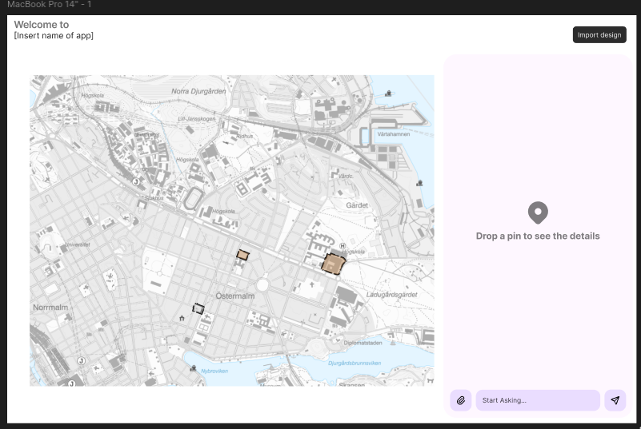
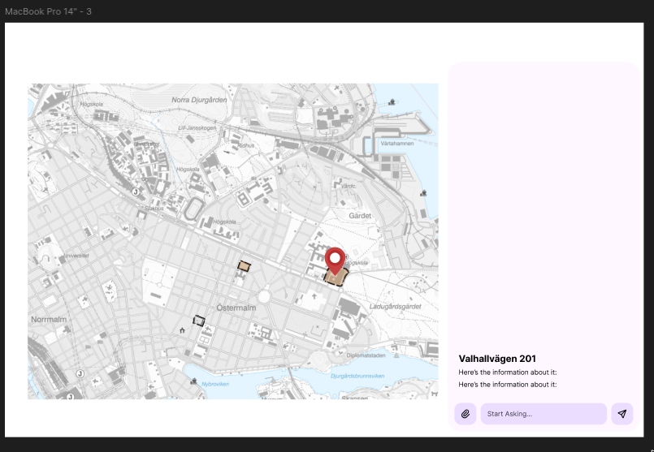
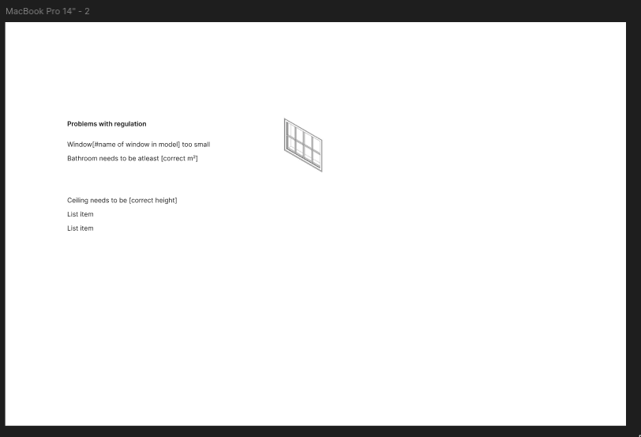
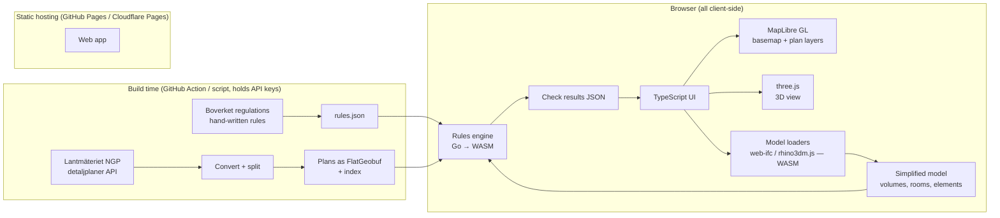

# [App name]

> Working title — the name is still open (the mockups say *"[Insert name of app]"*).

A web tool for architecture students to check whether a building design fits the **detaljplan** for its site and the **Swedish building regulations** (Boverket's byggregler). Drop a pin on the map, import a model from Revit, Rhino or SketchUp, and get a list of what passes, what fails, and what has to be checked by hand — with each problem linked to the exact part of the model and the regulation it comes from.

The whole app is a **static web page**: no login, no backend, and the model never leaves the student's computer. Heavy work (reading models, running the rule checks) happens in the browser with **WebAssembly**.

Built as a project in a human–computer interaction course.

---

## Design

### 1. Start: pick a site



- Full map of the city using Lantmäteriet's grey (*nedtonad*) topographic map style.
- Areas covered by a digital detaljplan are outlined on the map.
- The right-hand panel invites the user to *drop a pin to see the details*.
- **Import design** (top right) opens the model import.
- The input at the bottom (*Start asking…*) lets the user ask questions about the site or the results. The paperclip attaches a model file.

### 2. Pin dropped: site details



- Dropping a pin selects the property (fastighet) and the detaljplan that covers it.
- The panel shows the address (here *Valhallavägen 201*) and the plan's key regulations: allowed use, max height, building area, prickmark, plan ID and date it became legally binding (*laga kraft*).

### 3. Check results: problems with the regulations



- A list of everything in the model that breaks a rule, for example:
  - *Window [name in model] too small*
  - *Bathroom needs to be at least [x] m²*
  - *Ceiling height needs to be at least [x] m*
- Selecting a problem shows the failing element (here a window) and the rule text with a link to its source.

---

## What it should do

### Site and detaljplan
- Search for an address or property, or drop a pin on the map.
- Find the detaljplan that applies at that point and show its regulations in plain language.
- Draw plan areas on the map: building zones, **prickmark** (land that may not be built on), **korsmark**, height limits, and so on.
- Older plans that only exist as scanned PDFs are shown as a link to the PDF, with a clear note that they **can't be checked automatically**.

### Model import

| Program | How to get the model into the app | Read in the browser with |
|---|---|---|
| **Revit** | Export as **IFC** (File → Export → IFC) | [`web-ifc`](https://github.com/ThatOpen/engine_web-ifc) (WASM) |
| **Rhino** | Upload the **.3dm** file directly, or export as IFC | [`rhino3dm.js`](https://github.com/mcneel/rhino3dm) (WASM) |
| **SketchUp** | Export as **IFC** (SketchUp Pro). There's no browser reader for `.skp` files | `web-ifc` (WASM) |

- IFC is the main format because it carries meaning: walls, windows, rooms and storeys, not just shapes. Room-based checks (bathroom size, ceiling height) need that.
- `.3dm` files carry geometry and layers but not much meaning. The app asks the user to map layers to building parts (for example *"Layer `Fönster` = windows"*) or limits itself to volume checks (height, footprint, position).
- **Placement:** student models are rarely georeferenced. After import, the user moves and rotates the building into place on the map. IFC files that already have coordinates in SWEREF 99 TM are placed automatically.

### Checks
Two groups of checks, shown separately:

**Detaljplan** — checked against the model's volume and position:
- Height (nockhöjd, byggnadshöjd, totalhöjd)
- Building area (byggnadsarea, BYA) and floor area (BTA), as m² or % of the property
- Number of storeys
- Building on prickmark or outside allowed zones
- Distance to the property boundary

**Building regulations** — checked against rooms and elements in the model:
- Room sizes (for example bathroom area)
- Ceiling heights
- Window sizes and daylight-related minimums
- Accessibility basics (door widths, entrance level)

Every check ends in one of four states:

| State | Meaning |
|---|---|
| ✅ Pass | The model meets the rule |
| ❌ Fail | The model breaks the rule — shows by how much, and where |
| 👁 Check manually | The rule needs human judgement (for example *"anpassas till omgivningen"*) |
| ❔ Missing data | The model lacks what's needed (for example no rooms in the IFC) |

The app must **never show a pass it can't back up**. When it's unsure, it says so.

### Questions (chat panel)
The *Start asking…* field lets users ask things like *"Why does my window fail?"* or *"What does e1 mean in this plan?"*.

> ⚠️ **Open question:** a real AI assistant needs a language model API, which means an API key and therefore a server (see [API keys](#api-keys-and-why-there-is-no-runtime-backend)). Options:
> 1. Rule-based answers only: explain any check or plan regulation from the data the app already has. Works fully static.
> 2. Add a small serverless function that holds the LLM key. Breaks the "no backend" goal.
> 3. Treat it as a design concept in the prototype and test it with a Wizard-of-Oz setup.
>
> For the HCI course, option 1 or 3 is enough.

---

## Architecture



### Stack

| Part | Choice | Why |
|---|---|---|
| UI | TypeScript (+ a light framework such as Svelte or React) | Most of the needed libraries are JavaScript |
| Map | [MapLibre GL JS](https://maplibre.org/) | Open source, handles both raster and vector tiles |
| 3D view | [three.js](https://threejs.org/) | Standard for 3D in the browser; used by IFC viewers |
| IFC reading | `web-ifc` (C++ → WASM) | Fast IFC parsing in the browser |
| Rhino reading | `rhino3dm.js` (C++ → WASM) | McNeel's official `.3dm` library |
| Rules engine | **Go → WASM** (`GOOS=js GOARCH=wasm`, or TinyGo for smaller files) | Same engine could later run as a CLI or on a server |
| Plan data | FlatGeobuf (or PMTiles) on static hosting | The browser fetches only the part it needs with HTTP range requests, so there's no database server |
| Hosting | GitHub Pages / Cloudflare Pages | Free and static |

### Rules engine (WASM)
The engine is a pure function with one boundary between TypeScript and Go, so there are few slow calls across the JS↔WASM border:

```
check(model, plan, rules) → results
```

**Input** (JSON from TypeScript):
```json
{
  "model": {
    "footprint": [[674210.2, 6581340.1], "..."],
    "ridgeHeight": 6.9,
    "storeys": 2,
    "rooms": [{ "id": "R12", "type": "bathroom", "area": 3.6, "ceilingHeight": 2.35 }],
    "windows": [{ "id": "W-04", "name": "Fönster sovrum", "width": 0.9, "height": 1.1 }]
  },
  "plan": { "id": "0180K-P2023/04", "regulations": ["..."] },
  "ruleset": "boverket-2026"
}
```

**Output:**
```json
{
  "results": [
    {
      "ruleId": "dp.prickmark",
      "group": "detaljplan",
      "status": "fail",
      "message": "0.8 m of the building is on prickmark",
      "elements": ["footprint"],
      "source": { "title": "Detaljplan 0180K-P2023/04", "url": "…" }
    },
    {
      "ruleId": "bfs.room.ceilingHeight",
      "group": "regulations",
      "status": "fail",
      "message": "Ceiling height 2.35 m, minimum 2.40 m",
      "elements": ["R12"],
      "source": { "title": "BFS 2024:…", "url": "…" }
    }
  ]
}
```

The UI uses `elements` to highlight failing parts in the 3D view, and `source` to show and link the rule text.

---

## Data

### Map
- **Lantmäteriet's Topografisk webbkarta, *nedtonad* (grey)** matches the design. It's available as WMTS in SWEREF 99 TM and Web Mercator, but it requires a Lantmäteriet (Geotorget) account and credentials, even for the open-data overview version.
- Because credentials can't be hidden in a static site, the options are:
  1. **Default for development:** OpenStreetMap-based vector tiles (for example [OpenFreeMap](https://openfreemap.org/)), styled grey to match the design. No key needed.
  2. **Lantmäteriet map in production:** a tiny proxy (for example a Cloudflare Worker) that adds the credentials and only accepts requests from the app's domain.
- Map data © Lantmäteriet / © OpenStreetMap contributors, shown as attribution on the map.

### Detaljplaner
- Since 1 January 2022, new detaljplaner must be digital, and municipalities publish them through Lantmäteriet's **Nationella geodataplattformen (NGP)**.
- A build script fetches the plans for the areas the app supports (starting with **Stockholm**), converts them, and publishes static files.
- Plan regulations are matched against Boverket's **planbestämmelsekatalog** (open data, JSON/XML) so common regulations can be checked automatically. Regulations the municipality wrote as free text become *check manually*.
- Plans adopted before the digital requirement are mostly scanned PDFs → shown, not checked.
- Definitions such as *byggnadshöjd* depend on when the plan was adopted. The engine has to use the definition that was in force at that time.

### Building regulations
- Boverket's **new building regulations (BFS 2024:6–13)** replaced BBR and EKS on 1 July 2025. The transition period ended on 30 June 2026, so only the new rules apply to new cases.
- Exception: **energy requirements are still in BBR**, since Boverket hasn't issued replacement energy rules yet.
- Regulations are legal text and can't be scraped straight into checks. Each checkable requirement is written by hand as a structured rule in `rules/*.json`:

```json
{
  "id": "bfs.room.ceilingHeight",
  "appliesTo": "room",
  "where": { "type": ["living", "bedroom", "kitchen"] },
  "check": { "property": "ceilingHeight", "op": ">=", "value": 2.40, "unit": "m" },
  "source": { "title": "BFS 2024:…", "section": "…", "url": "…" }
}
```

> Numbers in this README are examples. Every rule must be verified against the current regulation text before it goes into `rules/`.

---

## API keys and why there is no runtime backend

Any key used by code running in the browser can be read by the user: it shows up in the request in DevTools → Network. Hiding it in obfuscated JavaScript or compiled WASM doesn't change that. So:

- **No secret keys in the app.** Ever.
- Keys live only in the **build script** (as GitHub Actions secrets), which fetches data and publishes plain static files.
- If something must be fetched live with a key (the Lantmäteriet map, an LLM for the chat), it goes through a small proxy that holds the key. That's the only server-side code, and it's optional.

---

## Project structure (proposed)

```
.
├── web/                  # TypeScript app (UI, map, 3D view, loaders)
├── engine/               # Go rules engine, compiled to WASM
│   ├── cmd/wasm/         # WASM entry point (exposes check())
│   └── rules/            # Rule evaluation logic
├── rules/                # Hand-written rule definitions (JSON)
├── data-pipeline/        # Build scripts: fetch NGP plans → FlatGeobuf
├── proxy/                # Optional Cloudflare Worker for map tiles / LLM
└── docs/
    └── images/           # Design mockups
```

---

## Known limitations

- Only plans that exist in digital form can be checked automatically.
- Only areas included in the build pipeline are covered (Stockholm first).
- Rule coverage is limited to requirements that can be measured from a model. Many regulations need professional judgement.
- Results depend on how well the model is built and exported (correct storeys, room types, units).
- **This is a learning tool, not an official review.** The building permit process (bygglov) at the municipality is what counts.

---

## Roadmap

1. **Prototype (HCI course):** Figma/clickable prototype of the three screens, then user tests with architecture students.
2. **Map + plan lookup:** MapLibre, pin drop, show plan regulations for one municipality.
3. **Model import:** IFC and `.3dm` loading, placement on the map, 3D view.
4. **Rules engine v1:** Go → WASM with detaljplan volume checks (height, BYA, prickmark).
5. **Building regulation checks:** rooms, ceiling heights, windows.
6. **Later:** live sync from Rhino/Grasshopper (or Speckle), more municipalities, chat answers.

---

## Sources

- [Lantmäteriet — Nationella geodataplattformen and digital detaljplaner](https://www.lantmateriet.se/)
- [Boverket — Planbestämmelsekatalogen (open data)](https://www.boverket.se/sv/PBL-kunskapsbanken/planering/detaljplan/planbestammelser/planbestammelsekatalogen/)
- [Boverket — Boverkets nya byggregler](https://www.boverket.se/sv/PBL-kunskapsbanken/regler-om-byggande/byggregelsystemet/nya-byggregler)
- [Boverket — Nu gäller Boverkets nya byggregler fullt ut](https://www.boverket.se/sv/om-boverket/nyheter-aktuellt/nyheter/nu-galler-boverkets-nya-byggregler/)
- [Lantmäteriet — Topographic web map, overview (open data)](https://www.lantmateriet.se/en/geodata/geodata-products/product-list/topographical-web-map-view-service-overview/)
